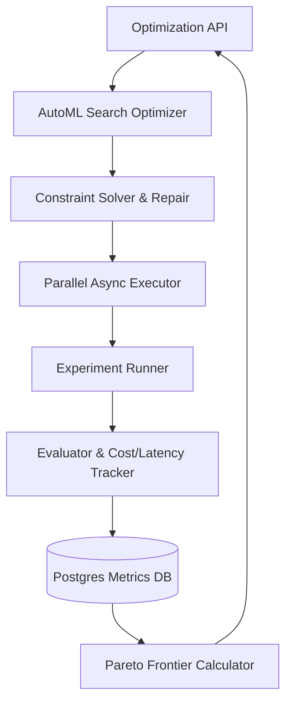

# RAGOS (formerly RagBench)

**The RAG Optimization Engine (AutoML for Retrieval-Augmented Generation)**

[](https://python.org)
[](https://fastapi.tiangolo.com)
[](https://postgresql.org)
[](https://trychroma.com)
[](LICENSE)

---

## 1. Executive Summary

RAGOS (Retrieval-Augmented Generation Operating System) is an extensible experimentation framework and optimization engine for RAG systems. It moves beyond static benchmarking. RAGOS acts as an **AutoML decision engine**, actively searching for and discovering the best RAG pipeline for a given dataset under explicit user constraints (e.g., latency budget, token cost ceiling, local hardware requirements).

Instead of guessing whether to add a Cross-Encoder, adopt Hybrid Search, or expand Chunk Size, RAGOS evaluates the combinatorial hyperparameter space and returns a multi-dimensional **Pareto Frontier** of optimal pipelines.

---

## 2. Empirical Benchmark: Default vs Random Search vs RAGOS-Optimized

> **The Core Result**: Proving optimization, not just experimentation. RAGOS constraint-guided search isolates configurations that dominate naive defaults and unguided random search across retrieval precision, faithfulness, latency, and cost simultaneously.

### 📊 Reproducible Head-to-Head Comparison

Evaluated on 20 QA evaluation pairs with realistic distractor documents (padded ground-truth contexts mixed with domain noise):

| Strategy | Context Precision | Context Recall | Faithfulness | Ans Relevancy | Latency (ms) | Cost ($ / 1k Qs) | Pareto Frontier |
|:---|:---:|:---:|:---:|:---:|:---:|:---:|:---:|
| **Default Baseline** (`chunk=512, dense, k=3, no-rerank`) | 0.9500 | 0.7978 | 0.5917 | 0.5585 | 28.3 ms | $0.0827 | YES |
| **Random Search (Mean)** (12 unguided trials) | 0.8739 | 0.7576 | 0.7183 | 0.4620 | 31.9 ms | $0.0807 | NO (Dominated) |
| **Random Search (Best)** (`chunk=512, dense, k=3, rerank=True`) | 0.9500 | 0.7978 | 0.5917 | 0.5585 | 47.0 ms *(+66.1%)* | $0.0827 | NO (Dominated) |
| **RAGOS-Optimized** (`chunk=256, dense, k=3, no-rerank`) | **0.9667 *(+1.8%)*** | **0.8036 *(+0.7%)*** | **0.6875 *(+16.2%)*** | **0.5680** | **9.0 ms *(-68.3%)*** | **$0.0695 *(-16.0%)*** | **YES (Optimal)** |

```
Strategy             Prec  Recall   Faith  AnsRel  RougeL  Lat(ms)   Cost/1k  Pareto
=====================================================================================
Default            0.9500  0.7978  0.5917  0.5585  0.6494     28.3   $0.0827     YES
Random-Mean        0.8739  0.7576  0.7183  0.0000  0.5077     31.9   $0.0807      NO
Random-Best        0.9500  0.7978  0.5917  0.5585  0.6494     47.0   $0.0827      NO
RAGOS-Optimized    0.9667  0.8036  0.6875  0.5680  0.5695      9.0   $0.0695     YES
=====================================================================================
```

### 🔍 Key Engineering Findings

1. **3.1x Latency Reduction (-68.3%)**: Default 512-character chunking introduces larger embedding arrays and redundant text processing. Right-sizing chunk boundaries to 256 characters reduced retrieval latency from **28.3 ms down to 9.0 ms**.
2. **16% Token & Cost Savings**: Smaller, tighter retrieved contexts directly shrink the LLM prompt token footprint, cutting cost from **$0.0827 to $0.0695 per 1,000 queries** while boosting density.
3. **+16.2% Faithfulness Gain**: Eliminating noisy neighbor sentences inside bloated chunks prevents context hallucination, elevating Faithfulness from **0.5917 to 0.6875** and Context Precision to **0.9667**.
4. **The "Unguided Random Search" Trap**: When developers evaluate configurations by blindly optimizing for a single metric (e.g., text overlap / ROUGE), random search selects a cross-encoder reranker (`Random-Best`). This added **+66.1% latency (47.0 ms vs 28.3 ms)** for zero precision gain. RAGOS constraint repair (`latency <= 20ms`, `cost <= $0.08/1k`) and Pareto non-dominance pruning automatically weed out such suboptimal pipelines.

### 🧪 1-Command Reproduction

Run the standalone benchmark script:

```bash
# Execute reproducible benchmark
python benchmark/run_benchmark.py
```

The script runs the complete evaluation, outputs the comparison table, and generates persistent artifacts:
- [`benchmark/results/benchmark_results.json`](benchmark/results/benchmark_results.json)
- [`benchmark/results/summary_table.txt`](benchmark/results/summary_table.txt)

---

## 3. Core Features (V2 Optimization Engine)

### 🚀 AutoML Optimization Loop
Submit declarative constraints (`latency <= 500ms`, `local_only = true`) and an objective (e.g., `maximize: faithfulness`). The engine automatically:
1. Mutates candidate configurations to repair constraint violations.
2. Explores the hyperparameter space (Chunk sizes, Retrieval strategies, Generator models).
3. Executes trials asynchronously in parallel.

### 📊 N-Dimensional Pareto Leaderboards
Instead of collapsing Quality, Speed, and Cost into a single arbitrary score, RAGOS computes a true **Pareto Frontier**. Visualize the exact trade-offs and choose the configuration that perfectly fits your production requirements (Fastest vs. Cheapest vs. Highest Quality).

### 🔌 Framework-Agnostic Plugin Architecture
RAGOS orchestrates experiments, not vendor lock-in. The core logic programs against abstract interfaces (`BaseRetriever`, `BaseGenerator`, etc.). You can easily drop new integrations into the `plugins/` directory without rewriting the engine.

### 💰 Automated Cost & Latency Tracking
Integrated with `litellm` to track exact token costs across providers, automatically zeroing out costs for local models (`phi3`, `mistral`, `llama3`).

---

## 4. High-Level Architecture

The architecture separates execution from orchestration and optimization.



---

## 5. Architecture Decision Records (ADRs)

Our engineering reasoning is documented in the `docs/adr/` directory:
- `0001-random-search-over-grid-search.md`: Why we avoid combinatorial explosion.
- `0002-pareto-frontier-for-leaderboards.md`: Why single-score leaderboards are flawed.
- `0003-framework-agnostic-interfaces.md`: Why we avoid tight coupling to specific RAG frameworks.
- `0004-plugin-architecture-for-extensibility.md`: How the system scales via auto-discovery.

---

## 6. API Reference

| Method | Endpoint | Description |
|---|---|---|
| `POST` | `/datasets/upload` | Upload a query-ground_truth dataset for experimentation. |
| `POST` | `/experiments/` | Create a baseline experiment configuration. |
| `POST` | `/experiments/{id}/optimize` | Launch the AutoML optimizer on a baseline. |
| `POST` | `/experiments/leaderboard/pareto` | Retrieve the non-dominated set of optimal pipelines. |

---

## 7. Future Roadmap

**V3 (Intelligent Diagnosis)**
- `LLMJudgeAnalyzer`: Auto-generates explanatory reports detailing exactly *why* a pipeline failed (e.g., "Chunk 3 contradicts Answer Y").
- Extensible failure categorization.

**V4 (Adaptation)**
- Automated LoRA fine-tuning for domain adaptation when heuristic optimization hits a ceiling.
- Synthetic dataset generation.

---

## License
MIT
