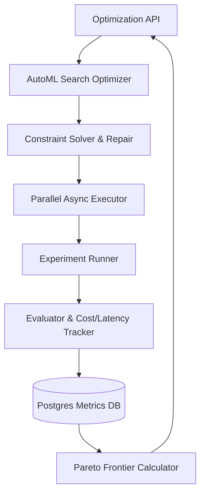

# RAGOS (formerly RagBench)

**The RAG Optimization Engine (AutoML for Retrieval-Augmented Generation)**

[](https://python.org)
[](https://fastapi.tiangolo.com)
[](https://postgresql.org)
[](https://trychroma.com)
[](LICENSE)

---

## 1. Executive Summary

RAGOS (Retrieval-Augmented Generation Operating System) is an extensible experimentation framework and optimization engine for RAG systems. It moves beyond static benchmarking. RAGOS acts as an **AutoML decision engine**, actively searching for and discovering the best RAG pipeline for a given dataset under explicit user constraints (e.g., latency budget, token cost ceiling, local hardware requirements).

Instead of guessing whether to add a Cross-Encoder, adopt Hybrid Search, or expand Chunk Size, RAGOS evaluates the combinatorial hyperparameter space and returns a multi-dimensional **Pareto Frontier** of optimal pipelines.

---

## 2. Empirical Benchmark: Baseline vs Random Search vs RAGOS Optimizer

> **Benchmark status**: this is a small, single-seed retrieval experiment. It is useful for comparing configurations on the included corpus; it is not an end-to-end generation evaluation or a production-latency guarantee.

### 📌 Scope & Measurement Attribution
- **Retrieval-Stage Latency**: Wall-clock execution time for dense vector search, sparse inverted indexing, hybrid fusion, and CrossEncoder reranking. *(Generation-stage latency is excluded as it depends on external LLM provider infrastructure).*
- **Token Footprint & Cost**: Evaluates prompt tokens consumed by retrieved context chunks, with projected input cost modeled at standard provider rates ($0.150 per 1M input tokens).
- **Evaluation Corpus**: 20 synthetic technical QA pairs evaluated against multi-paragraph passages alongside 10 technical distractor documents.
- **Production SLA Constraints**: `latency <= 20ms`, `cost <= $0.080 / 1k queries`.
- **Search Budget**: both unguided search and constraint-screened RAGOS evaluate 12 unique candidate configurations. A candidate must meet the measured SLA to be eligible; the benchmark never substitutes an invalid fallback.
- **Metric scope**: `Evidence Recall` is lexical coverage of reference content words. `Extractive Groundedness` is a lexical-overlap diagnostic and is not LLM faithfulness. `Query–Context Similarity` is query-to-extractive-context similarity and is not generated-answer relevancy. The sparse path uses Jaccard token overlap, not BM25.

### 📊 Reproducible Head-to-Head Comparison

Run the command below to generate machine-specific results. Retrieval latency depends on installed model versions and hardware, so checked-in aggregate numbers are not treated as portable performance claims.

### 🔍 Key Engineering Findings

1. **Integrated optimizer engine**: the benchmark exercises `RandomOptimizer`, `ConstraintSolver`, and `ParetoCalculator` directly.
2. **Measured constraints**: latency constraints are screened after execution, rather than assumed from a configuration heuristic.
3. **Pareto results are dataset-specific**: non-dominated configurations expose trade-offs; the benchmark does not claim that one strategy universally dominates every random trial.


### 🧪 1-Command Reproduction

Execute the reproducible benchmark:

```bash
python benchmark/run_benchmark.py
```

Generated artifacts:
- [`benchmark/results/benchmark_results.json`](benchmark/results/benchmark_results.json)
- [`benchmark/results/summary_table.txt`](benchmark/results/summary_table.txt)

---

## 3. Core Features (V2 Optimization Engine)

### 🚀 AutoML Optimization Loop
Submit declarative constraints (`latency <= 500ms`, `local_only = true`) and an objective (e.g., `maximize: faithfulness`). The engine automatically:
1. Mutates candidate configurations to repair constraint violations via `ConstraintSolver`.
2. Explores the hyperparameter space (Chunk sizes, Retrieval strategies, Generator models).
3. Executes trials asynchronously in parallel.

### 📊 N-Dimensional Pareto Leaderboards
Instead of collapsing Quality, Speed, and Cost into a single arbitrary score, RAGOS computes a true **Pareto Frontier** via `ParetoCalculator`. Visualize the exact trade-offs and choose the configuration that perfectly fits your production requirements (Fastest vs. Cheapest vs. Highest Quality).

### 🔌 Framework-Agnostic Plugin Architecture
RAGOS orchestrates experiments, not vendor lock-in. The core logic programs against abstract interfaces (`BaseRetriever`, `BaseGenerator`, etc.). You can easily drop new integrations into the `plugins/` directory without rewriting the engine.

### 💰 Automated Cost & Latency Tracking
Integrated with `litellm` to track exact token costs across providers, automatically zeroing out costs for local models (`phi3`, `mistral`, `llama3`).

---

## 4. High-Level Architecture

The architecture separates execution from orchestration and optimization.



---

## 5. Architecture Decision Records (ADRs)

Our engineering reasoning is documented in the `docs/adr/` directory:
- `0001-random-search-over-grid-search.md`: Why we avoid combinatorial explosion.
- `0002-pareto-frontier-for-leaderboards.md`: Why single-score leaderboards are flawed.
- `0003-framework-agnostic-interfaces.md`: Why we avoid tight coupling to specific RAG frameworks.
- `0004-plugin-architecture-for-extensibility.md`: How the system scales via auto-discovery.

---

## 6. API Reference

| Method | Endpoint | Description |
|---|---|---|
| `POST` | `/datasets/upload` | Upload a query-ground_truth dataset for experimentation. |
| `POST` | `/experiments/` | Create a baseline experiment configuration. |
| `POST` | `/experiments/{id}/optimize` | Launch the AutoML optimizer on a baseline. |
| `POST` | `/experiments/leaderboard/pareto` | Retrieve the non-dominated set of optimal pipelines. |

---

## 7. Future Roadmap

**V3 (Intelligent Diagnosis)**
- `LLMJudgeAnalyzer`: Auto-generates explanatory reports detailing exactly *why* a pipeline failed (e.g., "Chunk 3 contradicts Answer Y").
- Extensible failure categorization.

**V4 (Adaptation)**
- Automated LoRA fine-tuning for domain adaptation when heuristic optimization hits a ceiling.
- Synthetic dataset generation.

---

## License
MIT
