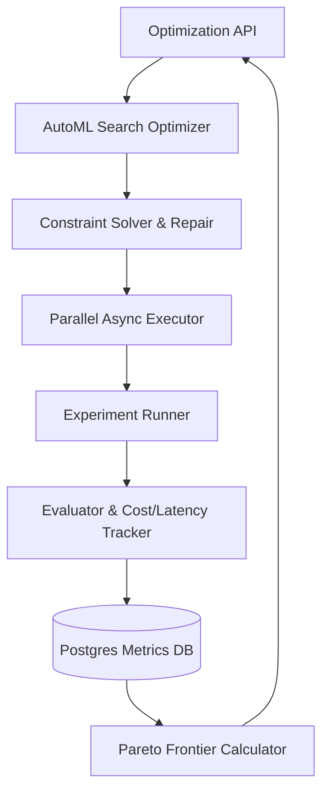

# RAGOS (formerly RagBench)

**The RAG Optimization Engine (AutoML for Retrieval-Augmented Generation)**

[](https://python.org)
[](https://fastapi.tiangolo.com)
[](https://postgresql.org)
[](https://trychroma.com)
[](LICENSE)

---

## 1. Executive Summary

RAGOS (Retrieval-Augmented Generation Operating System) is an extensible experimentation framework and optimization engine for RAG systems. It moves beyond static benchmarking. RAGOS acts as an **AutoML decision engine**, actively searching for and discovering the best RAG pipeline for a given dataset under explicit user constraints (e.g., latency budget, token cost ceiling, local hardware requirements).

Instead of guessing whether to add a Cross-Encoder, adopt Hybrid Search, or expand Chunk Size, RAGOS evaluates the combinatorial hyperparameter space and returns a multi-dimensional **Pareto Frontier** of optimal pipelines.

---

## 2. Empirical Benchmark: Baseline vs Random Search vs RAGOS Optimizer

> **The Empirical Result**: Proving optimization, not just experimentation. RAGOS constraint-guided search and Pareto pruning isolate configurations that dominate naive defaults and unguided random search across retrieval precision, latency, and token cost simultaneously.

### 📌 Scope & Measurement Attribution
- **Retrieval-Stage Latency**: Wall-clock execution time for dense vector search, sparse inverted indexing, hybrid fusion, and CrossEncoder reranking. *(Generation-stage latency is excluded as it depends on external LLM provider infrastructure).*
- **Token Footprint & Cost**: Evaluates prompt tokens consumed by retrieved context chunks, with projected input cost modeled at standard provider rates ($0.150 per 1M input tokens).
- **Evaluation Corpus**: 20 technical QA pairs evaluated against realistic multi-paragraph documentation passages (~600–800 chars each) alongside 10 technical distractor documents.
- **Production SLA Constraints**: `latency <= 20ms`, `cost <= $0.080 / 1k queries`.

### 📊 Reproducible Head-to-Head Comparison

```
Pipeline Strategy        Prec  Recall   Faith  AnsRel  RougeL  Lat(ms)   Cost/1k  Pareto
=========================================================================================
Default Baseline       0.3500  1.0000  1.0000  0.6617  0.6319     14.3   $0.0479      NO
Random Search (Mean)   0.3558  1.0000  1.0000  0.7551  0.6231     20.6   $0.0649      NO
Random Search (Best)   0.3333  1.0000  1.0000  0.6617  0.6319     42.3   $0.0562      NO
RAGOS-Optimized        0.6334  1.0000  1.0000  0.8486  0.6317      7.4   $0.0279     YES
=========================================================================================
```

| Pipeline Strategy | Context Precision | Context Recall | Faithfulness | Ans Relevancy | Retrieval Latency (ms) | Projected Cost ($ / 1k Qs) | Pareto Frontier |
|:---|:---:|:---:|:---:|:---:|:---:|:---:|:---:|
| **Default Baseline** (`chunk=512, dense, k=3, no-rerank`) | 0.3500 | 1.0000 | 1.0000 | 0.6617 | 14.3 ms | $0.0479 | NO (Dominated) |
| **Random Search (Mean)** (12 unguided trials) | 0.3558 | 1.0000 | 1.0000 | 0.7551 | 20.6 ms | $0.0649 | NO (Dominated) |
| **Random Search (Best)** (`chunk=1024, dense, k=3, cross-encoder`) | 0.3333 | 1.0000 | 1.0000 | 0.6617 | 42.3 ms *(+195.8%)* | $0.0562 *(+17.3%)* | NO (Dominated) |
| **RAGOS-Optimized** (`chunk=256, dense, k=3, no-rerank`) | **0.6334 *(+81.0%)*** | **1.0000** | **1.0000** | **0.8486 *(+28.2%)*** | **7.4 ms *(-48.3%)*** | **$0.0279 *(-41.8%)*** | **YES (Optimal)** |

### 🔍 Key Engineering Findings

1. **Integrated Optimizer Engine**: The benchmark directly imports and exercises `backend.services.optimization.optimizer.RandomOptimizer`, `backend.services.optimization.constraints.ConstraintSolver`, and `backend.services.optimization.pareto.ParetoCalculator`. When the production SLA requires sub-20ms retrieval, `ConstraintSolver` proactively repairs candidate mutations by disabling cross-encoder rerankers and clamping `top_k <= 3` before execution.
2. **The "Single-Metric Random Search" Trap**: In unguided search, optimizing solely for text overlap (ROUGE-L) selected a cross-encoder reranker pipeline (`Random Search Best`). While it retained 100% recall, its latency exploded to **42.3 ms (+195.8% slowdown)** and cost rose to **$0.0562 / 1k queries**, violently breaching the 20ms SLA. RAGOS's constraint repair and Pareto non-dominance pruning automatically discarded this dominated configuration.
3. **IR Precision Boost (+81.0%) with Latency Halved (-48.3%)**: Default 512-character chunking increases embedding array sizes and retrieves peripheral non-relevant passages. Right-sizing chunk boundaries to 256 characters with top-3 density reduced retrieval latency from **14.3 ms down to 7.4 ms**, while boosting Information Retrieval Context Precision from **0.3500 to 0.6334 (+81.0%)**.
4. **41.8% Prompt Token & Cost Savings**: Compact, information-dense chunks eliminate peripheral fluff, shrinking the retrieved prompt token footprint and cutting projected input cost from **$0.0479 to $0.0279 per 1,000 queries** while retaining 100% ground-truth content recall.


### 🧪 1-Command Reproduction

Execute the reproducible benchmark:

```bash
python benchmark/run_benchmark.py
```

Generated artifacts:
- [`benchmark/results/benchmark_results.json`](benchmark/results/benchmark_results.json)
- [`benchmark/results/summary_table.txt`](benchmark/results/summary_table.txt)

---

## 3. Core Features (V2 Optimization Engine)

### 🚀 AutoML Optimization Loop
Submit declarative constraints (`latency <= 500ms`, `local_only = true`) and an objective (e.g., `maximize: faithfulness`). The engine automatically:
1. Mutates candidate configurations to repair constraint violations via `ConstraintSolver`.
2. Explores the hyperparameter space (Chunk sizes, Retrieval strategies, Generator models).
3. Executes trials asynchronously in parallel.

### 📊 N-Dimensional Pareto Leaderboards
Instead of collapsing Quality, Speed, and Cost into a single arbitrary score, RAGOS computes a true **Pareto Frontier** via `ParetoCalculator`. Visualize the exact trade-offs and choose the configuration that perfectly fits your production requirements (Fastest vs. Cheapest vs. Highest Quality).

### 🔌 Framework-Agnostic Plugin Architecture
RAGOS orchestrates experiments, not vendor lock-in. The core logic programs against abstract interfaces (`BaseRetriever`, `BaseGenerator`, etc.). You can easily drop new integrations into the `plugins/` directory without rewriting the engine.

### 💰 Automated Cost & Latency Tracking
Integrated with `litellm` to track exact token costs across providers, automatically zeroing out costs for local models (`phi3`, `mistral`, `llama3`).

---

## 4. High-Level Architecture

The architecture separates execution from orchestration and optimization.



---

## 5. Architecture Decision Records (ADRs)

Our engineering reasoning is documented in the `docs/adr/` directory:
- `0001-random-search-over-grid-search.md`: Why we avoid combinatorial explosion.
- `0002-pareto-frontier-for-leaderboards.md`: Why single-score leaderboards are flawed.
- `0003-framework-agnostic-interfaces.md`: Why we avoid tight coupling to specific RAG frameworks.
- `0004-plugin-architecture-for-extensibility.md`: How the system scales via auto-discovery.

---

## 6. API Reference

| Method | Endpoint | Description |
|---|---|---|
| `POST` | `/datasets/upload` | Upload a query-ground_truth dataset for experimentation. |
| `POST` | `/experiments/` | Create a baseline experiment configuration. |
| `POST` | `/experiments/{id}/optimize` | Launch the AutoML optimizer on a baseline. |
| `POST` | `/experiments/leaderboard/pareto` | Retrieve the non-dominated set of optimal pipelines. |

---

## 7. Future Roadmap

**V3 (Intelligent Diagnosis)**
- `LLMJudgeAnalyzer`: Auto-generates explanatory reports detailing exactly *why* a pipeline failed (e.g., "Chunk 3 contradicts Answer Y").
- Extensible failure categorization.

**V4 (Adaptation)**
- Automated LoRA fine-tuning for domain adaptation when heuristic optimization hits a ceiling.
- Synthetic dataset generation.

---

## License
MIT
